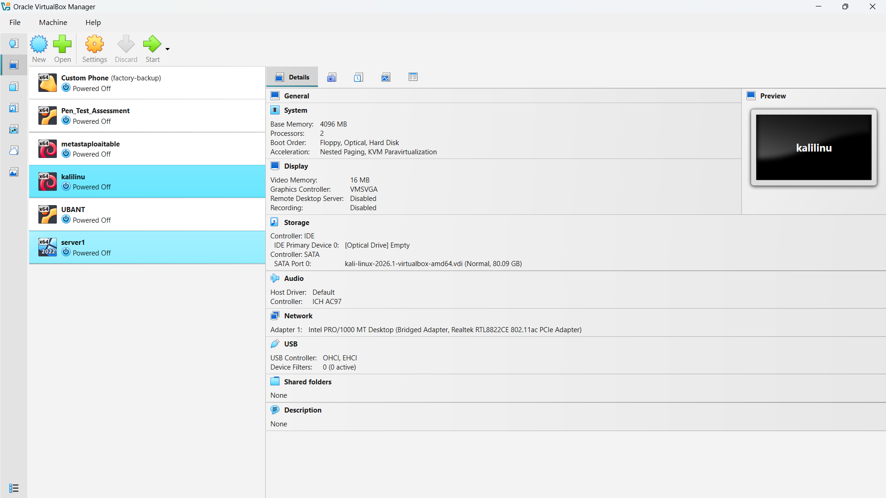
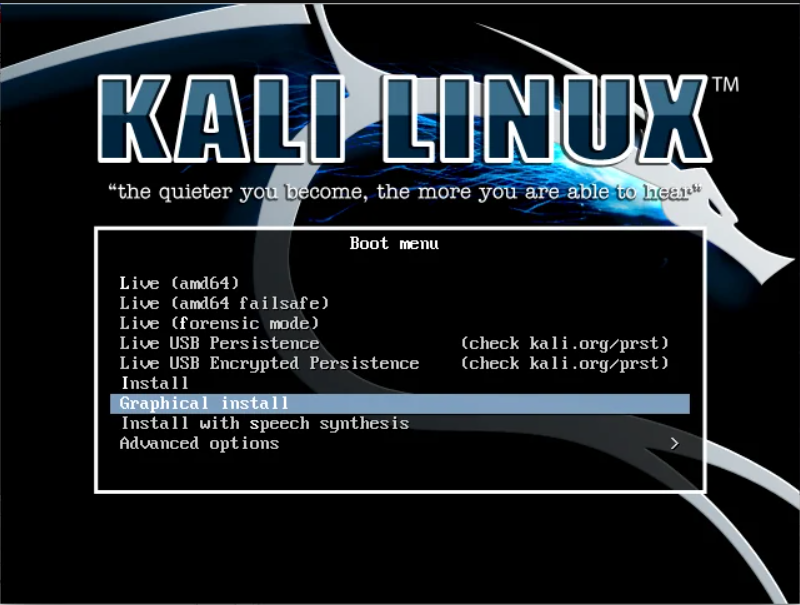
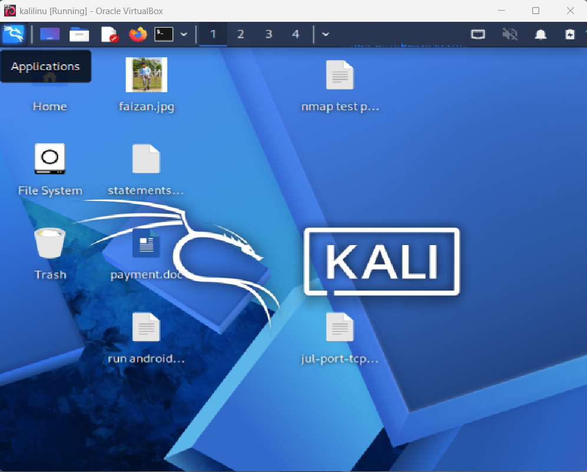
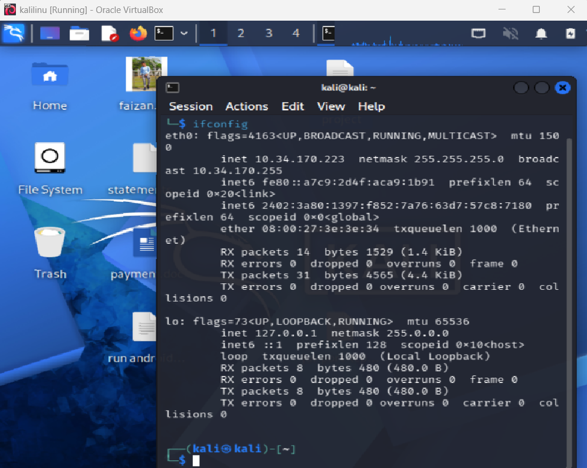

# 🛡️ Cybersecurity Home Lab Setup | Kali Linux & VirtualBox

<p align="center">
  
  
  
  
</p>

## 📌 Project Overview

This project demonstrates my personal Cybersecurity Home Lab setup using **Kali Linux and Oracle VirtualBox**.

The main objective is to create a virtual environment for learning cybersecurity concepts, understanding networking, exploring security tools, and performing authorized security testing.

## 🎯 Project Objectives

- Set up a virtual cybersecurity lab environment.
- Install and configure Kali Linux.
- Understand virtual machine configuration.
- Learn basic networking concepts.
- Explore cybersecurity tools.
- Practice security testing in an isolated lab environment.

## 🖥️ Lab Environment

| Component | Details |
|---|---|
| Host Operating System | Windows |
| Virtualization Platform | Oracle VirtualBox |
| Guest Operating System | Kali Linux |
| Lab Type | Virtual Cybersecurity Lab |
| Purpose | Cybersecurity Learning & Practice |

## 🛠️ Tools & Technologies

| Tool | Purpose |
|---|---|
| Kali Linux | Security testing environment |
| Oracle VirtualBox | Virtual machine management |
| Nmap | Network discovery and security auditing |
| Wireshark | Network traffic analysis |
| Burp Suite | Web application security testing |
| Metasploit | Security testing framework |

## ⚙️ Lab Setup Process

1. Installed Oracle VirtualBox.
2. Downloaded the Kali Linux ISO image.
3. Created a new virtual machine.
4. Configured RAM and virtual hard disk.
5. Installed Kali Linux.
6. Completed initial system configuration.
7. Verified the virtual machine environment.

## 🌐 Lab Architecture

```text
       Host Machine (Windows)
                |
                |
        Oracle VirtualBox
                |
                |
          Kali Linux VM
                |
        -----------------
        |       |       |
      Nmap  Wireshark  Burp Suite
        |
   Security Learning
   & Lab Experiments
```

## 📚 Learning Outcomes

- Understanding Linux operating system basics.
- Virtual machine installation and configuration.
- Basic networking and IP addressing.
- Network scanning concepts.
- Network traffic analysis.
- Introduction to web application security.
- Hands-on cybersecurity lab experience.

## 📸 Screenshots

## 📸 Lab Setup Screenshots

### 1. VirtualBox Setup


### 2. Kali Linux Installation


### 3. Kali Linux Desktop


### 4. Kali Linux Terminal


```text

```

## 🔐 Disclaimer

This lab is created strictly for educational purposes and authorized cybersecurity testing.

All security experiments should be performed only in your own lab environment or on systems where you have explicit permission.

## 👨‍💻 Author

**FAIZAN SHAIKH**

Cybersecurity Enthusiast | Aspiring SOC Analyst | VAPT Learner

GitHub: [@faizsk1892-lang](https://github.com/faizsk1892-lang)

---

⭐ If you find this project useful, feel free to explore my other cybersecurity learning projects.
